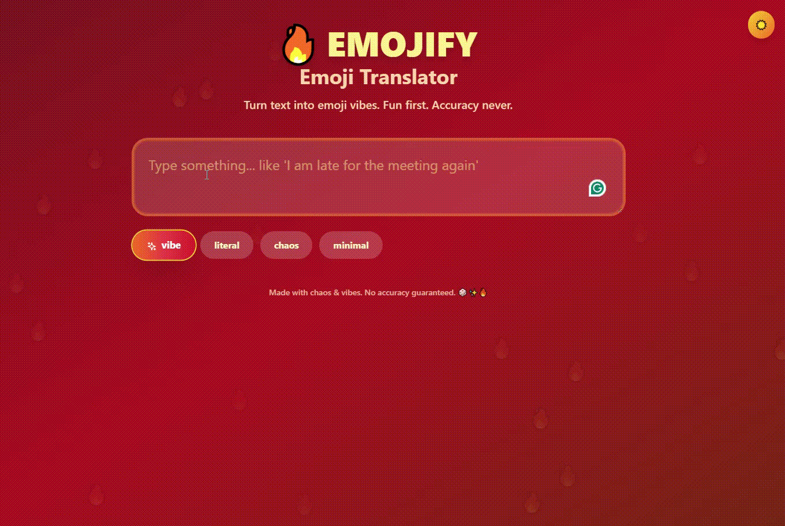

# ✨ EMOJIFY

Say it in emoji. See if your friends get it. 🎲 Live at [emojify.co](https://emojify.co).

<!-- Demo GIF -->
<div align="center">
  
  
  
</div>

## What is This?

A party game. You type something true ("my ex still has my hoodie"), it comes back as a fill-in-the-blanks riddle with the key words swapped for emojis ("My 💔 still has my 👕"), and you send the link to friends. Each friend gets three tries; an AI judges every guess and roasts the wrong ones; you see who got it and every wrong guess. Then they send one back.

Everything is free. There are no accounts: your browser keeps a random player id, your name, and a secret key for each riddle you made (that key unlocks its results).

## Features

- 🧩 **Fill-in-the-blanks riddles with friends**: the small words and one or two clue words stay, the rest become emojis (`src/lib/riddleText.js` checks that a riddle only shows words from its own sentence, hides at least a third of the key words and keeps at least 30% of the words; the AI gets two tries, then the offline version stands in); topics to start from (my ex, my weekend, my job…), six styles (easy, hard and roast up front; gen z, flirty and passive-aggressive behind "more styles"), each with a one-line explanation and its own example on the flyer, a link per riddle (`/?r=id`) whose preview reads "Can you guess what Maria said? 🐱☕💥"
- ⚖️ **An AI judge**: accepts synonyms and paraphrases ("kitty spilled my latte" counts), writes a one-line reaction to each guess, and never gets to hint at the answer (a reaction that uses a word from the secret is swapped for a canned one)
- 📬 **Your riddles**: who played, who got it in how many tries, every guess with the judge's line, and a count of new guesses in the nav and the tab title
- 🔁 **Send one back**: the end of every game puts the player in front of the composer
- 📅 **EMOJIFY Daily**: one movie or song a day in emoji, the same for everyone, five guesses, a hint after each miss, local streaks, and a spoiler-free result to paste into groups (`EMOJIFY Daily #12 🎬 🟥🟨🟩 3/5`). Answers live server-side in `functions/api/_daily-puzzles.js` (set `DAILY_EPOCH` to your launch day, add more at the end) and are checked by `functions/api/daily.js`
- ✍️ **A live flyer**: while you type, the offline riddle maker (`src/lib/emojify.js`, 1,600+ dictionary words, fuzzy spelling) rewrites the poster instantly in the chosen style; it also stands in whenever the AI is busy
- 🌶️ **Cheeky words** (`src/data/spicyEmojis.js`): PG-13, exact match only
- 🖼️ **Riddle cards** for Stories and group chats, with the riddle's own link on them
- 🌓 **Kraft / black-wall themes**, responsive from phones up

The look is Hallmark's Paste-up theme: plain CSS on tokens in `src/tokens.css`. Link-preview image: `public/og.png`.

## How It Works

| Piece | Where |
| --- | --- |
| Make a riddle (AI) | `POST /api/translate` → `functions/api/translate.js`, prompts in `functions/api/_shared.js` |
| Store a riddle | `POST /api/riddle` → Cloudflare D1 (`DB`), schema in `migrations/` |
| Play | `GET /api/riddle?id&player`, `POST /api/riddle/guess` (3 tries per player, the answer only once they're done) |
| Judge | `functions/api/_riddle.js`: exact match first, then the same guess judged before, then the AI, then word overlap if the AI is down |
| Creator's results | `POST /api/riddle/results` with each riddle's owner key |
| Link previews | `functions/index.js` rewrites the page's meta tags for `/?r=` links |
| AI provider | `functions/api/_ai.js`: OpenRouter, a chain of three free models (`AI_MODELS` overrides) |

Topics live in `src/data/topics.js` (shared by page and server), styles in `src/data/styles.js`.

## Run it locally

```bash
npm install
# .dev.vars (gitignored)
OPENROUTER_API_KEY=sk-or-...

npx wrangler d1 migrations apply emojify --local
npm run build && npx wrangler pages dev dist
```

## Deploy

```bash
npx wrangler d1 migrations apply emojify --remote   # only when migrations/ changed
npm run build && npx wrangler pages deploy dist --project-name emojify --branch main
```

The Pro unlock ($4.90, license keys) was switched off when everything went free; its server endpoints (`functions/api/license`, `functions/api/stripe`) are still there, unused, and [SETUP-MONETIZATION.md](./SETUP-MONETIZATION.md) describes them.

## Examples

- "I am late for the meeting again" → ⏰🚨💼📅😤
- "Happy birthday!" → 🎂🎉🎈🎊✨
- "I love pizza" → ❤️🍕😍

## License

MIT
